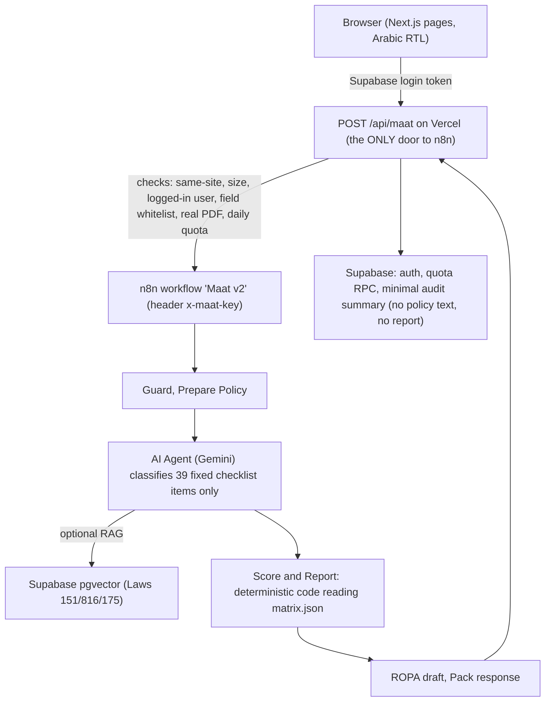
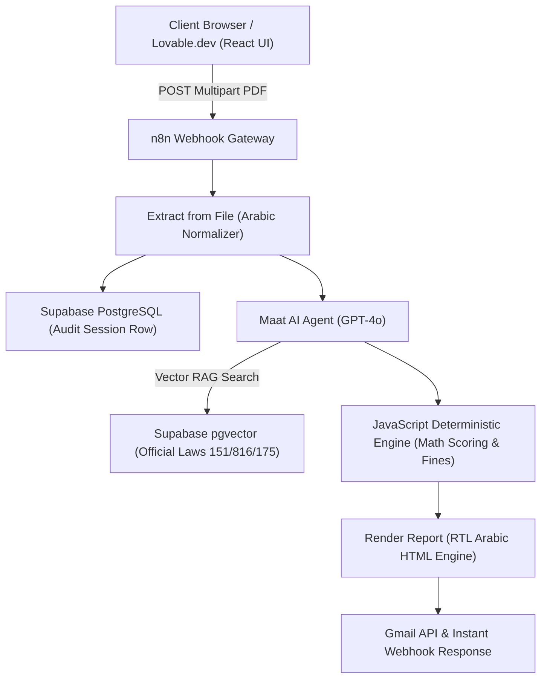
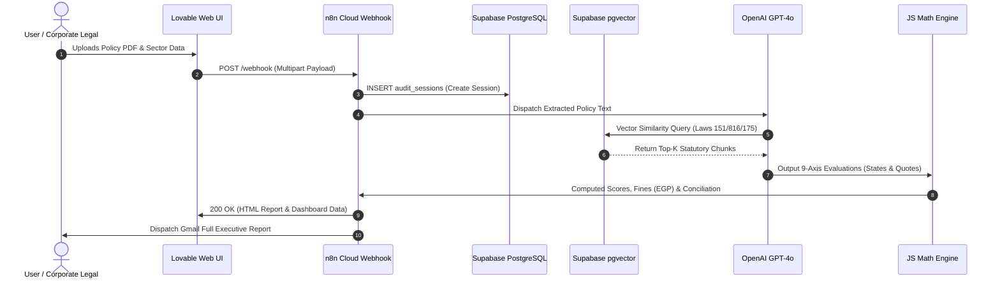
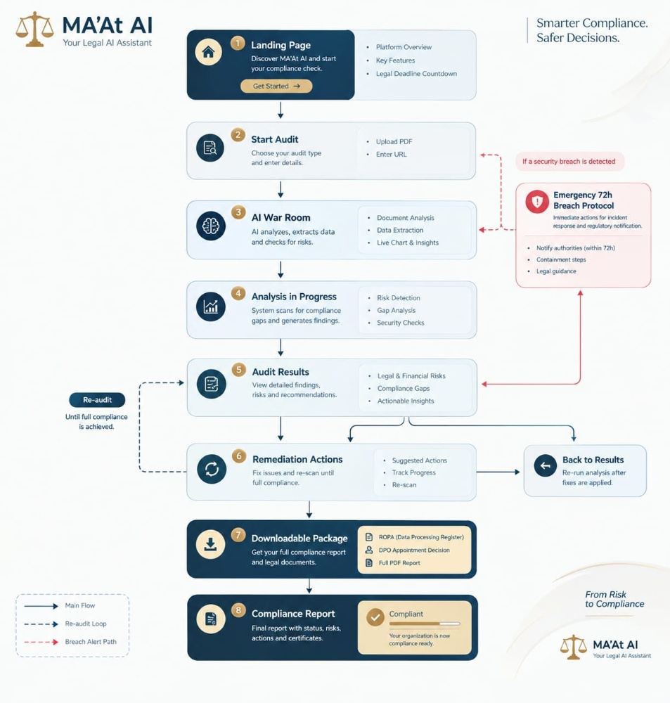

# AI Regulatory Compliance & Cyber-Legal Defense Engine
**Digital Egypt Pioneers Initiative (DEPI) — Industry Track**

### Team Members:
- Mohamed Hosny (Project Lead & Legal Framework Lead)
- Shaimaa Khaled (System Analyst & UI/UX Lead)
- Yara Tarek (Knowledge Base & Data Engineer)
- Ahmed El-Sherif (Workflow Automation Engineer)
- Mohamed Abdelhaleem (QA & Cyber Testing Lead)

### Milestone Deliverables:
- [x] **Milestone 1:** [Project_Planning_and_Management_DEPI_Milestone_1.pdf](./Project_Planning_and_Management_DEPI_Milestone_1.pdf)
- [x] **Milestone 2:** [Milestone_2_System_Analysis_and_Design_DEPI_Final.pdf](./Milestone_2_System_Analysis_and_Design_DEPI_Final.pdf)

## Working Implementation (v2) — this repository

The code in this repository is the running version of the platform: a Next.js web app on Vercel, an n8n workflow, and Supabase. The detailed run-book is in [`CLAUDE.md`](./CLAUDE.md) (written for Claude Code, readable by everyone).

Key design rules:
- The AI only **classifies** the checklist; scores, fines, Article 49 settlement and risk level come from deterministic code (`n8n/src/score.js` + `n8n/src/matrix.json`). Any AI quote that does not appear word for word in the policy is downgraded to "Not Determinable".
- The legal matrix belongs to the legal lead. Results are shown as *advisory* until `LEGAL_REVIEW_APPROVED` is set to `true` after lawyer sign-off.
- Secrets live only in Vercel env vars, n8n credentials and a local `.env.local` (never committed). See `.env.example`.

| Path | What it is |
|---|---|
| `app/`, `components/`, `lib/` | Web app and the security gate (`app/api/maat/route.ts`, `lib/proxy.ts`) |
| `n8n/Maat_v2.json` | The workflow to import into n8n (generated from `n8n/src`) |
| `n8n/src/` | Source of the Code nodes and the legal matrix (`matrix.json`) |
| `supabase/schema.sql` | Tables, Row Level Security, quota function (safe to re-run) |
| `tests/` | 67 workflow tests + 20 API-gate tests |
| `scripts/sync-n8n.mjs` | Copies `n8n/src` into `Maat_v2.json` (`npm run sync:n8n`) |

This is a **prototype on free services, by design**. What is already closed, what is deferred to a paid production setup, and the statement for judges: [`docs/PRODUCTION-ROADMAP.md`](./docs/PRODUCTION-ROADMAP.md).

Local run: `npm install`, create `.env.local` from `.env.example`, `npm run dev` (http://localhost:3000). Full check before any push: `npm run check`.

> The diagrams below are the original Milestone 2 design (OpenAI GPT-4o, Lovable UI, Gmail delivery) and are kept for the project record. The v2 implementation above uses Gemini and a Next.js front end, and does not send Gmail.

## System Architecture & Interaction Workflows (Original Milestone 2 Design)

### 1. High-Level Component Architecture

### 2. End-to-End Sequence Diagram

---

## 🎨 UI/UX Architecture & User Journey

### 1. End-to-End User Flow & Incident Response
The diagram below illustrates the complete platform lifecycle, including dual-intake processing, iterative remediation loops, and the dedicated 72-hour emergency breach protocol:

---

### 2. Core System Wireframes & Design System
- **Screen 1 — Landing Page:** Regulatory countdown banner (Law 151/2020 & Exec Reg 816/2025) and core mission overview.
- **Screen 2 — Dual Audit Intake & AI War Room:** File upload (PDF) vs live domain audit (URL) with SSRF safeguards, live pipeline stages, and Risk Radar.
- **Screen 3 — Audit Results & Regulatory Action:** Real statutory penalty ranges (Law 151 & Law 175 Art. 33), Art. 49 pre-trial conciliation calculator (50% statutory reduction), and emergency breach alert.
- **Screen 4 — UX Journey & Design System:** Multi-tier remediation loop and enterprise color palette (Navy `#142C3B`, Gold `#CDA963`, Success `#377E5B`).

* 📄 **Static Documentation:** [View Full Wireframes PDF](docs/ui-ux/wireframes_system.pdf)
* 🔗 **Interactive Prototype:** [Explore Live Design on Canva](https://canva.link/c6m2pclgmjk4wc1)
