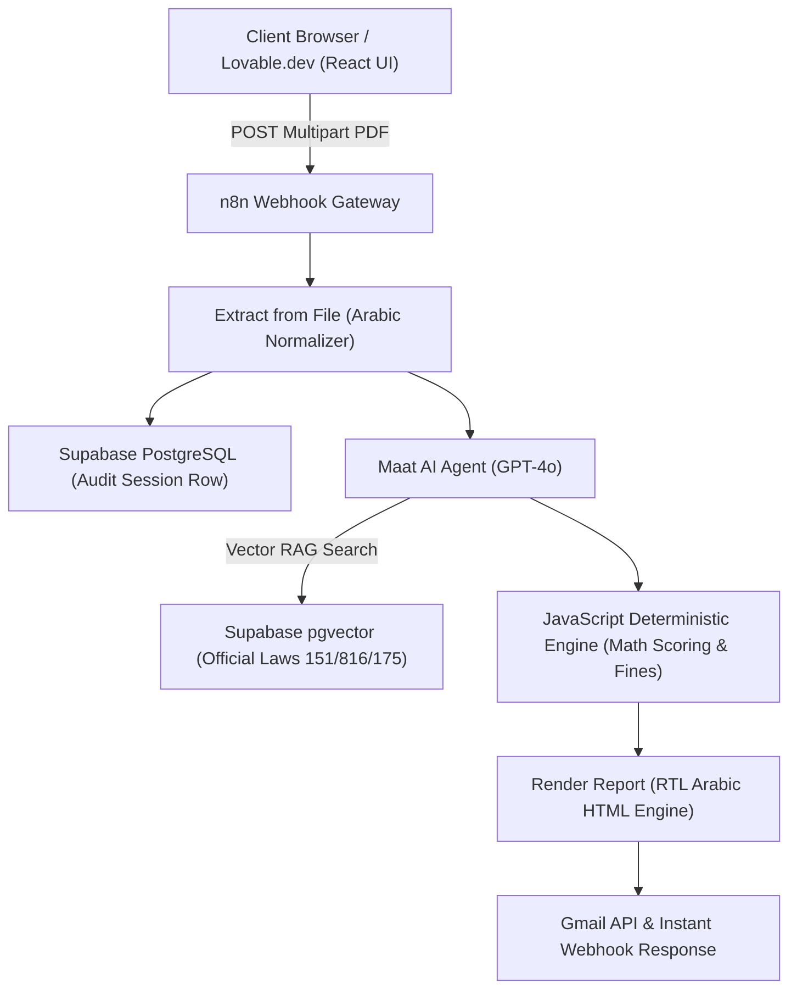
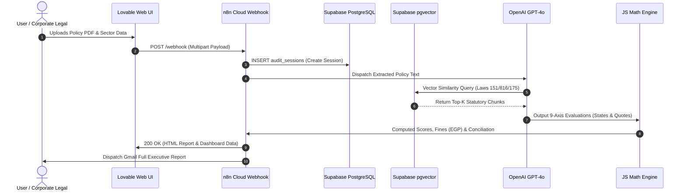

# AI Regulatory Compliance & Cyber-Legal Defense Engine
**Digital Egypt Pioneers Initiative (DEPI) — Industry Track**

### Team Members:
- Mohamed Hosny (Project Lead & Legal Framework Lead)
- Shaimaa Khaled (System Analyst & UI/UX Lead)
- Yara Tarek (Knowledge Base & Data Engineer)
- Ahmed El-Sherif (Workflow Automation Engineer)
- Mohamed Abdelhaleem (QA & Cyber Testing Lead)

### Milestone Deliverables:
- [x] **Milestone 1:** [Project_Planning_and_Management_DEPI_Milestone_1.pdf](./Project_Planning_and_Management_DEPI_Milestone_1.pdf)
- [x] **Milestone 2:** [Milestone_2_System_Analysis_and_Design_DEPI_Final.pdf](./Milestone_2_System_Analysis_and_Design_DEPI_Final.pdf)

## System Architecture & Interaction Workflows

### 1. High-Level Component Architecture

### 2. End-to-End Sequence Diagram

---

## 🎨 UI/UX Architecture & User Journey

### 1. End-to-End User Flow & Incident Response
The diagram below illustrates the complete platform lifecycle, including dual-intake processing, iterative remediation loops, and the dedicated 72-hour emergency breach protocol:

---

### 2. Core System Wireframes & Design System
- **Screen 1 — Landing Page:** Regulatory countdown banner (Law 151/2020 & Exec Reg 816/2025) and core mission overview.
- **Screen 2 — Dual Audit Intake & AI War Room:** File upload (PDF) vs live domain audit (URL) with SSRF safeguards, live pipeline stages, and Risk Radar.
- **Screen 3 — Audit Results & Regulatory Action:** Real statutory penalty ranges (Law 151 & Law 175 Art. 33), Art. 49 pre-trial conciliation calculator (50% statutory reduction), and emergency breach alert.
- **Screen 4 — UX Journey & Design System:** Multi-tier remediation loop and enterprise color palette (Navy `#142C3B`, Gold `#CDA963`, Success `#377E5B`).

* 📄 **Static Documentation:** [View Full Wireframes PDF](docs/ui-ux/wireframes_system.pdf)
* 🔗 **Interactive Prototype:** [Explore Live Design on Canva](https://canva.link/c6m2pclgmjk4wc1)
